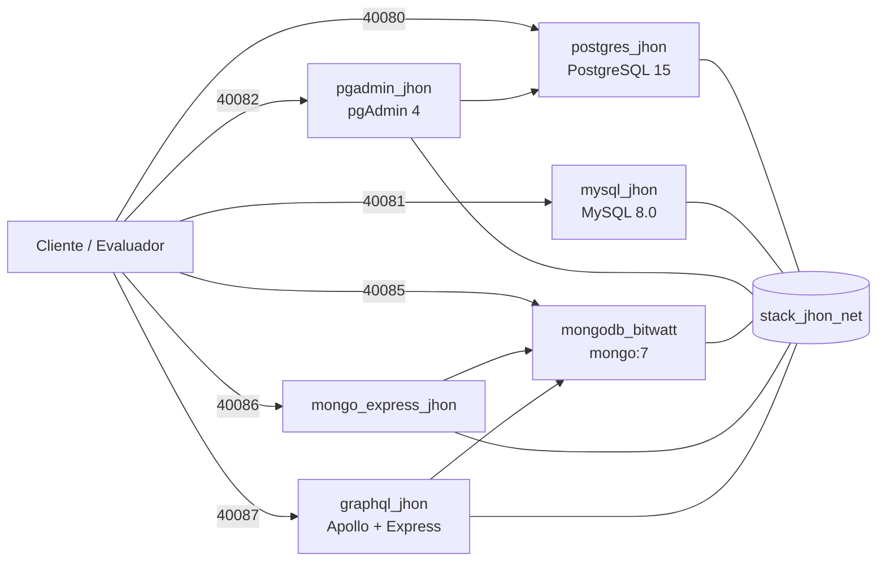

# UTXJ — Unidad 2: Implementación y administración de bases de datos NoSQL en la nube

> **Institución:** Universidad Tecnológica de Xicotepec de Juárez (UTXJ)  
> **Programa:** Ingeniería en Tecnologías de la Información e Innovación Digital  
> **Asignatura:** Optativa I — Bases de Datos en la Nube (Unidad 2)  
> **Docente evaluador:** Marco Antonio Ramirez Hernandez  
> **Fecha de evaluación:** 20 de noviembre de 2026  
> **Rama de trabajo:** `Manual_VPS_BDs_NoSQL` (NO se fusiona a `main`)  
> **VPS:** Hostinger · Linux · IP pública `5.183.9.45`

---

## 1. Arquitectura del stack



- Los servicios **PostgreSQL, MySQL y pgAdmin de la Unidad 1 se conservan intactos**.
- `./mongodb` se monta en `/docker-entrypoint-initdb.d` de `mongo:7`: los seis scripts
  `.js` se ejecutan **en orden alfabético solo la primera vez** que el volumen
  `mongo_data_jhon` está vacío.
- `./graphql` se construye con su propio `Dockerfile` (Node 20 alpine) y se conecta
  a `mongodb_bitwatt:27017/ecommerce_nosql` mediante `MONGO_URI`.

### Puertos

| Servicio | Contenedor | Host | Interno | Base / propósito |
|---|---|---:|---:|---|
| `postgres_jhon` | `postgres_jhon` | 40080 | 5432 | `db_40080` / usuario `jhony40080` |
| `mysql_jhon` | `mysql_jhon` | 40081 | 3306 | `db_test_7b` / usuario `jhon_jojos` |
| `pgadmin_jhon` | `pgadmin_jhon` | 40082 | 80 | Consola web PostgreSQL |
| `mongodb_jhon` | `mongodb_bitwatt` | **40085** | 27017 | `ecommerce_nosql` / root configurable |
| `mongo_express_jhon` | `mongo_express_jhon` | **40086** | 8081 | Consola web MongoDB |
| `graphql_jhon` | `graphql_jhon` | **40087** | 40087 | API GraphQL `/graphql` + `/health` |

**Volúmenes:** `postgres_data_jhon`, `mysql_data_jhon`, `mongo_data_jhon`  
**Red:** `stack_jhon_net` (bridge)

---

## 2. Despliegue en el VPS (5.183.9.45)

```bash
# 0) Acceso y preparación
ssh root@5.183.9.45
apt update && apt install -y git docker.io docker-compose-plugin ufw
systemctl enable --now docker
git clone https://github.com/gJhony/PRACTICAS_240080_CORRECCION.git
cd PRACTICAS_240080_CORRECCION
git checkout Manual_VPS_BDs_NoSQL
cd Manual_VPS_BDs_NoSQL

# 1) Credenciales: NUNCA versionar .env
cp .env.example .env
nano .env          # reemplazar TODOS los CAMBIAR_* por credenciales reales
chmod 600 .env

# 2) Firewall (ajusta tu IP de origen)
ufw allow 22/tcp
ufw allow 40080:40087/tcp
ufw enable

# 3) Validar y levantar
docker compose config
docker compose up -d --build

# 4) Ver estado y esperar a MongoDB healthy
docker compose ps
docker compose logs -f mongodb_jhon
```

Si MongoDB ya tenía datos y quieres **re-ejecutar los scripts de inicialización**,
debes recrear solo ese volumen (esto **borra** la BD NoSQL):

```bash
docker compose stop mongodb_jhon mongo_express_jhon graphql_jhon
docker volume rm practicas_240080_correction_mongo_data_jhon  # ver nombre exacto: docker volume ls
docker compose up -d mongodb_jhon mongo_express_jhon graphql_jhon
```

---

## 3. Estructura de entregables

```
Manual_VPS_BDs_NoSQL/
├── docker-compose.yml
├── .env.example
├── .gitignore
├── README.md
├── mongodb/
│   ├── 01_users_roles.js          # Apartado D: 7 roles + 7 usuarios
│   ├── 02_collections_schemas.js  # Apartado E: 4 colecciones con $jsonSchema
│   ├── 03_seed_data.js            # Apartado E: 12+12+12 documentos con IDs SQL reales
│   ├── 04_indexes.js              # Apartado E: índices simples y compuestos
│   ├── 05_views.js                # Apartado E: 5 vistas
│   └── 06_tests_crud.js           # Apartado F: CRUD + denegaciones + col_logs
├── graphql/
│   ├── Dockerfile
│   ├── package.json
│   └── src/{index,schema,resolvers,audit,roles,db,scalars}.js
├── evidencias/
│   └── (capturas del VPS que se pegan en el reporte)
├── Reporte_Unidad2_Equipo.docx
└── Reporte_Unidad2_Equipo.pdf
```

---

## 4. Matriz de los 7 roles e-commerce

| Rol | Usuario MongoDB | Privilegios principales | Acceso a `col_logs` |
|---|---|---|---|
| `superadmin` | `usr_superadmin` | Control total (`readWrite`, `dbAdmin`, `userAdmin`) | Lectura + escritura |
| `admin` | `usr_admin` | CRUD en todas las colecciones y vistas | Lectura + escritura |
| `seller` | `usr_seller` | Lee direcciones/vistas; crea y edita reseñas; actualiza envíos | Solo INSERT |
| `buyer` | `usr_buyer` | Administra sus direcciones, crea reseñas, consulta envíos | Solo INSERT |
| `support` | `usr_support` | Lee todo; modera reseñas; cambia estatus de envío | Lectura + INSERT |
| `common` | `usr_common` | Solo vistas públicas + direcciones propias | Solo INSERT |
| `not_registered` | `usr_not_registered` | **Únicamente** `find` sobre `vw_public_reviews` | **DENEGADO** |

Las contraseñas se toman de `MONGO_USR_<ROL>_PASSWORD` en `.env`.  
El rol `not_registered` está diseñado para que `db.col_users_adress.find()` falle con
`not authorized` y se registre como `AUTH_DENIED` en `col_logs`.

---

## 5. Consistencia referencial SQL → NoSQL (Indicador 39)

**Fuente real:** `C:\Users\mario\OneDrive\Escritorio\finalfinal.sql` (dump MySQL de
`db_test_7b`, prácticas BDN 240080). No es una carpeta: el archivo está directamente
en el Escritorio. Se inspeccionaron además los respaldos de `practicas-bdn` y el dump
PostgreSQL `db_test_7b_postgre.sql` para confirmar el origen.

| Entidad SQL | Tabla / columna | IDs reales usados en MongoDB |
|---|---|---|
| Usuarios | `tb_users.id_user` | `2, 5, 6, 7, 8, 9, 11, 12, 13, 14, 16, 17` |
| Personas | `tb_people.id_people` | `5, 6, 7, 8, 9, 10, 11, 12, 13, 14, 15, 16` |
| Productos | `tb_products.id_product` | `1, 2, 3, 4, 5, 6, 7, 8, 9, 10, 11, 12` |
| Pedidos / envíos | `tb_buyer_orders.id_buyer_order`, `tb_shipments.id_shipment` | **El dump no contiene filas** en esas tablas (`LOCK TABLES ... WRITE` vacío).Por ello `id_order` se correlaciona con `tb_people.id_people` real y se documenta en cada documento con `origen_sql`. Al cargar pedidos reales, sustituir por `tb_buyer_orders.id_buyer_order`. |

Ejemplos verificables del dump:

```sql
INSERT INTO `tb_users` VALUES (2,'240080@utxicotepec.edu.mx','JEIG',...);
INSERT INTO `tb_people` VALUES (5,2,'Sr./Sra.','JEIG',...),(6,5,'Sr./Sra.','SARA',...);
INSERT INTO `tb_products` VALUES (1,'BOING-MNG-500','Boing Mango',...);
```

Verificación desde MongoDB:

```javascript
db.col_users_adress.countDocuments({ id_user: { $in: [2,5,6,7,8,9,11,12,13,14,16,17] } })      // 12
db.col_products_reviews.countDocuments({ id_product: { $in: [1,2,3,4,5,6,7,8,9,10,11,12] } })  // 12
db.col_shipment_tracking.countDocuments({ id_people: { $in: [5,6,7,8,9,10,11,12,13,14,15,16] } }) // 12
```

---

## 6. Conexión remota con mongosh (desde fuera del contenedor)

```bash
mongosh "mongodb://<usuario>:<password>@5.183.9.45:40085/ecommerce_nosql?authSource=admin"

# Como usuario de un rol (la BD de autenticación es ecommerce_nosql):
mongosh "mongodb://usr_buyer:<password>@5.183.9.45:40085/ecommerce_nosql?authSource=ecommerce_nosql"

# O desde el VPS, dentro de la red stack_jhon_net:
docker compose exec mongodb_jhon mongosh \
  "mongodb://<root>:<password>@127.0.0.1:27017/ecommerce_nosql?authSource=admin"
```

Mongo Express: `http://5.183.9.45:40086` (Basic Auth de `.env`).

---

## 7. API GraphQL

- Endpoint: `http://5.183.9.45:40087/graphql`
- Healthcheck: `http://5.183.9.45:40087/health`
- Headers de contexto: `x-user`, `x-role`, `x-forwarded-for`, `x-request-id`.
- Toda operación se registra en `col_logs` de forma automática (`audit.js`).

### Query: resumen agregado con filtros y paginación

```graphql
query Resumen {
  productsRatingSummary(minReviews: 1, orden: "promedio_rating", limit: 5, offset: 0) {
    id_product
    promedio_rating
    total_resenas
    rating_maximo
  }
}
```

### Query: las 5 vistas

```graphql
query Vistas {
  publicReviews(limit: 3) { id_product rating comentario }
  activeShipmentsView(limit: 3) { id_order tracking_number estado ciudad_destino }
  userAddressesActiveView(limit: 3) { id_user ciudad codigo_postal }
  productsRatingSummaryView(limit: 3) { id_product promedio_rating total_resenas }
  auditLogsRecentView(limit: 3) { fecha_hora operacion usuario rol estado }
}
```

### Mutations

```graphql
mutation AltaResena($input: ReviewInput!) {
  createReview(input: $input) { _id id_product id_user rating estado_moderacion }
}
# Variables:
# { "input": { "id_product": 6, "id_user": 2, "id_people": 5,
#              "rating": 5, "comentario": "Excelente producto UTXJ" } }

mutation CambiarEstatus {
  updateShipmentStatus(input: { id_order: 5, estado: "en_transito",
                                descripcion: "Entregado a paquetería" }) {
    id_order estado fecha_envio
  }
}

mutation BorrarResena {
  deleteReview(idProduct: 6, idUser: 2) { eliminados descripcion }
}
```

### Ejemplo con `curl` (simulando visitante)

```bash
curl -s http://5.183.9.45:40087/graphql \
  -H 'Content-Type: application/json' \
  -H 'x-user: visitante' -H 'x-role: not_registered' \
  -H 'x-forwarded-for: 203.0.113.10' \
  --data '{"query":"{ publicReviews(limit:2){ id_product rating comentario } }"}'
```

Para provocar un `AUTH_DENIED`, cambia la query por `{ reviews { id_product } }`:
el visitante recibirá `FORBIDDEN` y aparecerá un registro en `col_logs`.

---

## 8. Pruebas, índices y auditoría

```bash
# Repetir pruebas CRUD/seguridad con autenticación ya activa.
# MONGO_HOST indica al script dónde abrir conexiones NUEVAS por rol, porque
# db.auth() no permite cambiar de usuario en una sesión ya autenticada como root.
# Dentro del contenedor es 127.0.0.1:27017; desde el VPS host es 127.0.0.1:40085.
docker compose exec -e MONGO_HOST=127.0.0.1:27017 mongodb_jhon mongosh --quiet \
  "mongodb://<root>:<pwd>@127.0.0.1:27017/ecommerce_nosql?authSource=admin" \
  --file /docker-entrypoint-initdb.d/06_tests_crud.js
# Resultado esperado con auth activa: RESUMEN: PASS=9  FAIL=0, con 4 AUTH_DENIED
# reales (not_registered, common, buyer, seller) escritos en col_logs.
# Durante initdb (sin auth) el esperado es PASS=5 FAIL=0: las denegaciones se
# validan al repetir el script contra el VPS ya arrancado.

# Planes de ejecución (executionStats)
docker compose exec mongodb_jhon mongosh --quiet "<URI>" --eval '
  db.col_products_reviews.find({id_product:6, rating:{$gte:4}}).explain("executionStats")
'

# Auditoría real
docker compose exec mongodb_jhon mongosh --quiet "<URI>" --eval '
  db.col_logs.find({operacion:"AUTH_DENIED"}).sort({fecha_hora:-1}).limit(5).pretty()
'
```

---

## 9. Seguridad

- `.env` y cualquier archivo de credenciales están ignorados por Git (`.gitignore`).
- `.env.example` contiene **solo placeholders** (`CAMBIAR_*`).
- No hay contraseñas, tokens ni secretos reales en ningún archivo versionado.
- `col_logs` jamás se siembra manualmente: se llena solo con operaciones reales de
  `06_tests_crud.js` y del middleware de auditoría de GraphQL.

## 10. Evidencias visuales

Las capturas reales del VPS se deben pegar en `Reporte_Unidad2_Equipo.docx` en los
espacios marcados `[PEGAR CAPTURA AQUÍ: ...]`. El panel gráfico generado
(`evidencias/panel_evidencias.html` y su PNG) resume arquitectura, puertos, roles e IDs.
