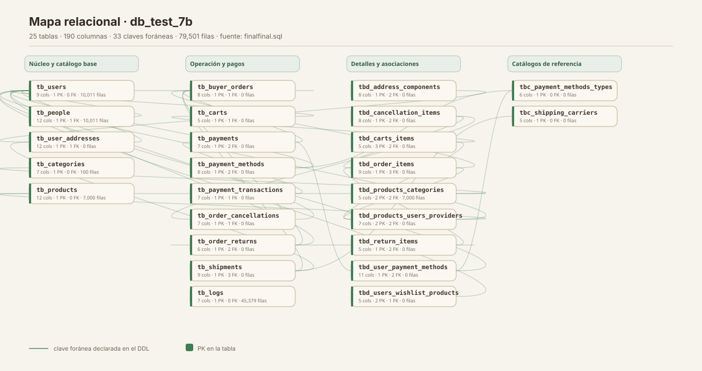

# Práctica 03: Diseño y documentación de una base de datos E-Commerce

## Documentación publicada

Todo el material se generó desde el respaldo **`backups/finalfinal.sql`** del esquema `db_test_7b`.

| Recurso | Descripción | Enlace directo |
|---|---|---|
| **Modelo EER interactivo final** | Modelo relacional con 25 tablas, atributos, PK/FK/UQ, relaciones y vistas guiadas. Cada tabla muestra sus totales. | [Abrir `page_final.html`](https://gjhony.github.io/PRACTICAS_240080_CORRECCION/page_final.html) |
| **Diccionario de datos completo** | Las 190 columnas, tipos, nulidad, defaults, claves, referencias y filas de cada tabla. | [Ver en Pages](https://gjhony.github.io/PRACTICAS_240080_CORRECCION/diccionario_final.html) · [Ver Markdown en GitHub](https://github.com/gJhony/PRACTICAS_240080_CORRECCION/blob/Practica03/Practicas03/docs/diccionario_final.md) |
| **Mapa relacional** | Vista estática de las 25 tablas en 4 dominios y sus relaciones, ideal para imprimir o compartir. | [Ver SVG](docs/assets/mapa_relacional_final.svg) · [Abrir en Pages](https://gjhony.github.io/PRACTICAS_240080_CORRECCION/assets/mapa_relacional_final.svg) |
| **Portada del sitio** | Índice de la práctica publicado en GitHub Pages. | [Abrir sitio](https://gjhony.github.io/PRACTICAS_240080_CORRECCION/) |

> El enlace del diccionario lleva a una página HTML publicada por GitHub Pages, así que se ve directamente en el navegador. El archivo Markdown sigue disponible para verlo con formato dentro de GitHub.

### Mapa relacional



> Las líneas verdes representan claves foráneas declaradas en el DDL; la franja verde de cada caja indica la tabla. Para explorar relaciones, atributos, filtros y totales por tabla, abre el [modelo interactivo](https://gjhony.github.io/PRACTICAS_240080_CORRECCION/page_final.html).

## Alcance del respaldo `finalfinal.sql`

| Concepto | Cantidad |
|---|---:|
| Tablas | 25 |
| Columnas | 190 |
| Claves foráneas declaradas | 33 (32 relaciones entre tablas distintas) |
| Filas en el respaldo | 79,501 |
| Triggers | 72 |
| Vistas | 26 |
| Procedimientos almacenados | 1 |

Los conteos describen el contenido del archivo SQL; no representan una consulta en vivo a un servidor. Solo 6 tablas tienen datos en el respaldo; las demás declaran 0 filas.

## Vista rápida del diccionario

| Dominio | Tablas | Columnas | Relaciones FK | Filas |
|---|---:|---:|---:|---:|
| Núcleo y catálogo base | 5 | 52 | 2 | 27,122 |
| Operación y pagos | 9 | 64 | 13 | 45,379 |
| Detalles y asociaciones | 9 | 63 | 18 | 7,000 |
| Catálogos de referencia | 2 | 11 | 0 | 0 |

| Tabla | Dominio | Columnas | PK | FK | Filas |
|---|---|---:|---|---:|---:|
| `tb_users` | Núcleo | 9 | `id_user` | 0 | 10,011 |
| `tb_people` | Núcleo | 12 | `id_people` | 1 | 10,011 |
| `tb_user_addresses` | Núcleo | 12 | `id_user_adress` | 1 | 0 |
| `tb_categories` | Núcleo | 7 | `id_category` | 0 | 100 |
| `tb_products` | Núcleo | 12 | `id_product` | 0 | 7,000 |
| `tb_buyer_orders` | Operación | 8 | `id_buyer_order` | 1 | 0 |
| `tb_carts` | Operación | 5 | `id_carts` | 1 | 0 |
| `tb_payments` | Operación | 7 | `id_payment` | 2 | 0 |
| `tb_payment_methods` | Operación | 8 | `id_payment_method` | 2 | 0 |
| `tb_payment_transactions` | Operación | 7 | `id_transaction` | 1 | 0 |
| `tb_order_cancellations` | Operación | 7 | `id_order_cancellation` | 1 | 0 |
| `tb_order_returns` | Operación | 6 | `id_return` | 2 | 0 |
| `tb_shipments` | Operación | 9 | `id_shipment` | 3 | 0 |
| `tb_logs` | Operación | 7 | `id_logs` | 0 | 45,379 |
| `tbd_address_components` | Detalles | 8 | `id_address_component` | 2 | 0 |
| `tbd_cancellation_items` | Detalles | 8 | `id_cancellation_item` | 2 | 0 |
| `tbd_carts_items` | Detalles | 5 | `id_cart` · `id_provider` · `id_product` | 2 | 0 |
| `tbd_order_items` | Detalles | 9 | `id_order_item` | 2 | 0 |
| `tbd_products_categories` | Detalles | 5 | `id_product` · `id_category` | 2 | 7,000 |
| `tbd_products_users_providers` | Detalles | 7 | `id_product_user_provider` · `id_product` | 2 | 0 |
| `tbd_return_items` | Detalles | 5 | `id_return_item` | 2 | 0 |
| `tbd_user_payment_methods` | Detalles | 11 | `id_user_payment_method` | 2 | 0 |
| `tbd_users_wishlist_products` | Detalles | 5 | `id_user_wishlist_product` · `id_product` | 1 | 0 |
| `tbc_payment_methods_types` | Catálogos | 6 | `id_payment_method_type` | 0 | 0 |
| `tbc_shipping_carriers` | Catálogos | 5 | `id_carrier` | 0 | 0 |

Para el detalle de cada columna (tipo SQL, nulidad, valor predeterminado, clave y referencia), abre el [diccionario completo](https://gjhony.github.io/PRACTICAS_240080_CORRECCION/diccionario_final.html).

## Descripción general

Esta práctica documenta una base de datos relacional para un sistema de comercio electrónico. El esquema `db_test_7b` organiza cuentas y personas, catálogo de productos y categorías, carritos y órdenes, pagos, envíos, devoluciones, reseñas y registros de auditoría.

- Diseño y lectura de entidades y relaciones para el dominio E-Commerce.
- Identificación de claves primarias, claves foráneas, restricciones y tablas de asociación.
- Documentación de los 72 triggers de auditoría, 26 vistas de trazabilidad y el procedimiento almacenado.
- Consultas SQL para inspeccionar objetos de la base y datos disponibles.
- Preparación de datos de ejemplo para productos y categorías.

## Recursos anteriores

| Recurso | Descripción | Enlace |
|---|---|---|
| Modelo final4 | Modelo interactivo de la versión anterior del esquema. | [Abrir final4](https://gjhony.github.io/PRACTICAS_240080_CORRECCION/archify/final4_model.html) |
| Modelo final3 | Versión previa del modelo. | [Abrir final3](https://gjhony.github.io/PRACTICAS_240080_CORRECCION/archify/final3_model.html) |
| Modelo etiquetado «final2» | Archivo histórico; su contenido corresponde a la versión final4, no a `final2.sql`. | [Abrir histórico](https://gjhony.github.io/PRACTICAS_240080_CORRECCION/modelo_eer_diccionario_final2.html) |
| Informe técnico anterior | Análisis del respaldo `final4.sql`. | [Leer informe](https://github.com/gJhony/PRACTICAS_240080_CORRECCION/blob/Practica03/Practicas03/docs/informe_final2.md) |
| Consultas de verificación | Consultas SQL para revisar tablas, triggers, bitácora y rutinas. | [Ver consultas](queries/consultas_verificaciones.sql) |

## Estructura del proyecto

```text
Practicas03/
├── README.md
├── backups/
│   └── finalfinal.sql                 # Respaldo fuente de la documentación final
├── docs/
│   ├── index.html                     # Portada de GitHub Pages
│   ├── page_final.html                # Modelo EER interactivo final con totales por tabla
│   ├── diccionario_final.md           # Diccionario renderizable en GitHub
│   ├── diccionario_final.html         # Diccionario publicado en GitHub Pages
│   ├── assets/
│   │   └── mapa_relacional_final.svg # Mapa relacional incrustable
│   ├── archify/
│   │   ├── final4_model.html          # Modelo histórico
│   │   └── final3_model.html          # Versión anterior
│   ├── modelo_eer_diccionario_final2.html  # Archivo histórico (contenido final4)
│   └── informe_final2.md              # Informe de la versión anterior
├── queries/
│   └── consultas_verificaciones.sql
├── scripts/                           # Configuración de usuarios remotos y privilegios
└── seeders/                           # Datos de ejemplo para carga
```

## Publicación en GitHub Pages

El flujo [deploy-pages.yml](../.github/workflows/deploy-pages.yml) publica automáticamente el contenido de `Practicas03/docs` al hacer push a la rama `Practica03`. También se puede iniciar manualmente desde **Actions → Publicar Practicas03 en GitHub Pages → Run workflow**.

La primera vez, si el sitio todavía no se publica, abre **Settings → Pages** en el repositorio y selecciona **GitHub Actions** como fuente de despliegue. El sitio publicado queda disponible en [gjhony.github.io/PRACTICAS_240080_CORRECCION](https://gjhony.github.io/PRACTICAS_240080_CORRECCION/).
